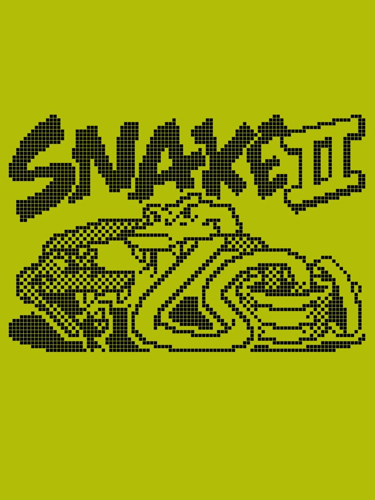

# Snake II — Nokia 3310 Inspired Remake

A browser-based remake of **Snake II** featuring a monochrome 84 × 48 LCD display, handcrafted pixel sprites, six selectable maze modes, and keyboard and touch controls. Built with **TypeScript**, **Canvas 2D**, and **Vite**.

[**Play on GitHub Pages**](https://aleksandargvozdenovic.github.io/snake-game/)



## Features

- **No Maze** with wraparound, plus five obstacle mazes
- Nine selectable speed levels
- Custom bitmap sprites and continuous one-pixel maze walls
- Food, time-limited bonus pickups, and locally saved high scores
- Wall-turn grace period, pause menu, and responsive touch controls
- Pixel-particle Game Over animation
- Shared **Instructions / How To Play** dialog with maze previews

## Controls

| Action | Keyboard |
| --- | --- |
| Up | `↑`, `W`, `8` |
| Down | `↓`, `S`, `2` |
| Left | `←`, `A`, `4` |
| Right | `→`, `D`, `6` |
| Turn 90° left / right | `*` / `#` |
| Pause | `P`, `C`, `Esc` |
| Skip Game Over animation | `Enter`, `Space`, or tap the LCD |

On mobile, use the onscreen directional controls or swipe on the playfield.

## Getting started

Requires Node.js 22 or newer.

```bash
npm ci
npm run dev
```

Run the test suite and production build:

```bash
npm test
npm run build
npm run preview
```

## Project structure

| Path | Responsibility |
| --- | --- |
| `src/nokia/game/` | Snake logic, maze layouts, sprites, collision, and death animation |
| `src/nokia/lcd/` | Monochrome framebuffer, pixel font, and Canvas renderer |
| `src/nokia/ui/` | Instructions dialog and maze previews |
| `src/styles/` | LCD layout and responsive styling |
| `src/main.ts` | Screen navigation, controls, and game lifecycle |
| `.github/workflows/deploy.yml` | GitHub Pages deployment |

## Maze accuracy

This is a **Nokia-inspired remake**, not a pixel-perfect extraction from the original game. No Maze follows the documented wraparound behavior. Maze 1 uses an adapted surrounding wall; Mazes 2–5 are fixed, playable reconstructions rather than verified original ROM layouts. The bonus scoring rule is also adapted for this remake.

## Deployment

Pushes to `main` trigger the GitHub Actions workflow, which runs tests, builds the site, and deploys the generated `dist/` folder. In the repository's **Settings → Pages**, set the source to **GitHub Actions**. The Vite base path is `/snake-game/`.

The original HTML/CSS/JavaScript edition is preserved on the `legacy/html-css-js` branch.
